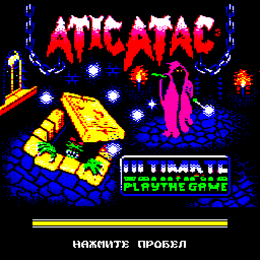
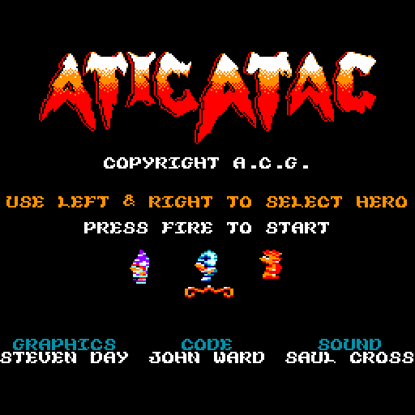
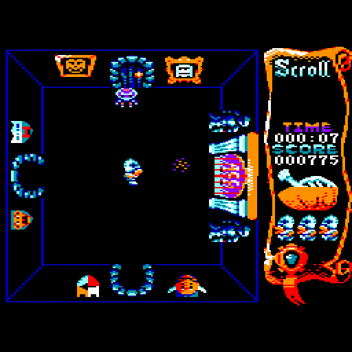
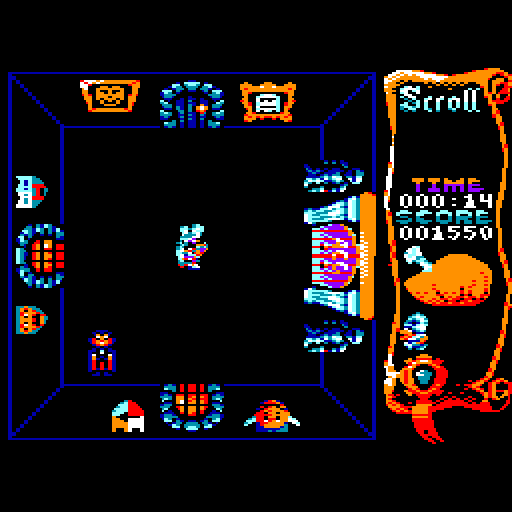

# Atic Atac → Вектор-06Ц

Порт **Atic Atac** (Ultimate Play the Game, 1983) на **Вектор-06Ц** по версии для Amstrad CPC 6128
([shaymanjohn/aticatac-cpc](https://github.com/shaymanjohn/aticatac-cpc), John Ward, 2021): КР580ВМ80А 3 МГц,
64 КБ ОЗУ, квазидиск 256 КБ, дисковод. Логика игры переведена с Z80 на i8080 и сверяется с оригиналом шаг в шаг;
вывод, ввод, звук и загрузка написаны заново под Вектор. Игра идёт с частотой 50 кадров в секунду, как на CPC.

| Заставка | Меню |
|---|---|
|  |  |

| Зал | Дракула |
|---|---|
|  |  |

## Готовый образ

| Файл | Что это |
|---|---|
| [`rom/aticatac.fdd`](rom/aticatac.fdd) | **игра целиком**: загрузочная дискета МикроДОС 820 КБ |

Нужен квазидиск 256 КБ. Загрузка с дискеты занимает около 23 секунд, после неё дискета больше не нужна.

- **MiSTer** (ядро Vector-06C): подключить `aticatac.fdd` как дискету, дождаться штатного ПЗУ и нажать
  **Alt+F11** (БЛК+СБР) — загрузка идёт с диска. На настоящем Векторе с НГМД — то же самое.
- **Emu80** (платформа «Вектор-06Ц»): `Emu80qt --platform vector --run aticatac.fdd`.

На **Векторе Турбо+** (и в ядре MiSTer `Vector-06C_turbo`) — два способа, как у других игр 06Ц на этой машине:
- со стартового экрана ПЗУ: держать РУС/ЛАТ при сбросе (на MiSTer — Alt и F10+F9), выбрать `FDD 0`, файл
  `ATICATAC.COM`, ВК, ещё раз ВК на частоте;
- из CP/M 4.0: дискета в A:, `A:`, `ATICATAC -V`.

Игра сама переводит Турбо+ в режим 06Ц и на 12 МГц (темп от этого не меняется). Квазидиск занимается весь —
файлы на диске квазидиска CP/M пропадут.

Звук: если есть AY (порты `$14`/`$15`), музыка и эффекты звучат через него; без AY — на ВИ53 (одним-двумя
голосами, без громкости). Игра находит AY сама. Плеер Arkos Tracker 2 переписан под i8080, поток регистров AY
совпадает с CPC кадр в кадр.

## Управление

| действие | клавиши |
|---|---|
| выбор героя в меню | ← → |
| старт / огонь | **пробел** |
| движение | стрелки |
| взять / бросить предмет | **Z** или **Я** (на месте Z у Вектора — Я) |
| бессмертие | в меню нажать **F1+F3** — игра начнётся в режиме god mode |

## Как устроен порт

```
ref/cpc (оригинал CPC, Z80) ──rasm──▶ эталонная сборка байт в байт с aticatac.dsk (tools/build_cpc.sh)
        │                                   │
        │                                   └─▶ модель CPC 6128 на JS (tools/cpc6128.js): эталонные прогоны,
        │                                       снимки меню и панели, запись звука
        └─▶ логика на JS (src/model) ──▶ логика на i8080 (src/i8080), сверка шаг в шаг (tools/lock80.js)
графика CPC ──tools/mkroom.py, mkgame.py──▶ квазидиск: комнаты, спрайты по фазам, панель, меню
src/vec — вывод по лучу, ввод, панель, меню, плеер звука, загрузчик с дискеты ──▶ rom/aticatac.fdd
```

- **Экран** — 256×256, 8 цветов в трёх плоскостях; четвёртая плоскость отдана коду. Точка CPC режима 0 — две
  точки Вектора, ступеньки на краях фигур сглажены (`tools/pixsmooth.py`); надписи не сглаживаются.
- **Вывод спрайтов** привязан к лучу: каждый объект перерисовывается, когда луч ушёл с его строк, поэтому нет
  мерцания и разрывов. Спрайты лежат в квазидиске заранее сдвинутыми по фазам.
- **Цвета.** 16 цветов CPC сведены к 8: часть врагов и боссов перерисована в 4 цвета (2 плоскости — быстрее);
  пурпурный CPC стал фиолетовым.
- Журнал работы со всеми числами и решениями — [docs/JOURNAL.md](docs/JOURNAL.md), план логики —
  [docs/LOGIC_PLAN.md](docs/LOGIC_PLAN.md), разведка — [docs/FEASIBILITY.md](docs/FEASIBILITY.md).

## Сборка

Нужны: Python 3 с Pillow, Node.js, **rasm 3.3.2** (собирает CPC-исходники и данные звука) и **sjasmplus 1.24**
(с ключом `--i8080`). Бинарники кладутся в `tools/rasm` и `tools/sjasmplus`. Исходники оригинала —
клон [shaymanjohn/aticatac-cpc](https://github.com/shaymanjohn/aticatac-cpc) в `ref/cpc`: из них берутся логика,
графика, комнаты, звук и заставка.

```sh
git clone https://github.com/shaymanjohn/aticatac-cpc ref/cpc
./build.sh          # tools/build_cpc.sh + tools/build_game.sh -> rom/aticatac.fdd
```

`tools/build_cpc.sh` сначала собирает CPC-версию и сверяет её с `ref/cpc/aticatac.dsk` байт в байт.
`data/holes.json` — список участков кода CPC, свободных для порта (`tools/holes.js` по эталонным прогонам).
`tools/emu80_run.sh [--fdd]` — запуск собранного в Emu80.

## Проверки

Стенды — headless-эмулятор Вектора на Node.js (`stand/vec`), кадр 59904 такта.

```sh
node stand/vec/shipcheck.js 3000      # логика собранной игры против JS-модели: 0 расхождений
SJFLAGS=-DECHK=1500 tools/build_game.sh && node stand/vec/gamerun.js 3000 /tmp/x   # стирание: 0 отличий от фона
LOOPST=1 node stand/vec/gamerun.js 1500 /tmp/x    # скорость: выводов в секунду, потерянные прерывания
node tools/akg80check.js              # плеер i8080 против записи AY с CPC: все мелодии и эффекты
for s in research/scenarios/*.json; do node tools/cpc_trace.js $s; done   # эталоны CPC (~2 мин)
node tools/lock80.js                  # логика i8080 против JS-модели на эталонах
```

## Состояние

**Версия 0.9, бета.** Игра проходится от меню до итогов, логика совпадает с CPC. Не сделано: анимация
появления героя и падения в люк, пауза и выход в меню (H, M), джойстик «П». Прохождение целиком на железе
не проверялось; на MiSTer проверены загрузка с дискеты, меню и игра. Вектор Турбо+: оба способа запуска
проверены на модели машины (vturbo-js) — загрузка, меню, игра; на MiSTer — проверяется.

## Источники и права

Оригинал — **Atic Atac**, Ultimate Play the Game, 1983 (Тим и Крис Стэмперы). Версия для Amstrad CPC —
John Ward (графика Steven Day, звук Saul Cross), [github.com/shaymanjohn/aticatac-cpc](https://github.com/shaymanjohn/aticatac-cpc);
у этого репозитория **нет лицензии**, все права на неё принадлежат её авторам. Из неё взяты логика игры
(переведена на i8080), графика, комнаты, музыка и эффекты, заставка. Порт сделан как любительский,
некоммерческий; если правообладатели против публикации — напишите, репозиторий будет закрыт.

Порт на Вектор-06Ц — Борис Лихачёв, 2026. Сторонние файлы перечислены в [NOTICE](NOTICE).
